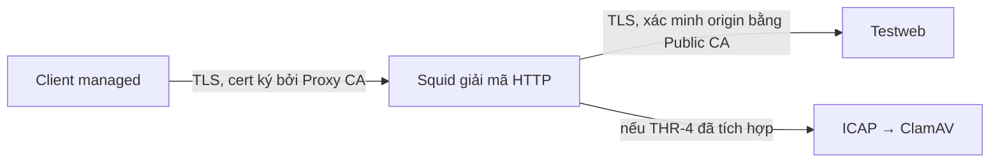

# HTTPS, SslBump và giới hạn kiểm soát — TV2

Tài liệu thiết kế cho TLS-3/4/5 và DOC-2. Số liệu chạy thật và trạng thái nghiệm thu được ghi riêng trong [trung-handoff.md](trung-handoff.md). DOC-2 vẫn cần một thành viên khác review.

## Ba chế độ của lab

| Chế độ | Staff | Guest/BYOD | Site thuộc `nobump_sni` |
|---|---|---|---|
| `splice` | Giữ TLS đầu cuối | Giữ TLS đầu cuối | Giữ TLS đầu cuối |
| `bump` | Proxy giải mã, client tin Proxy CA | Lỗi xác minh vì không tin Proxy CA | Vẫn bị bump |
| `selective` | Bump các site còn lại | Splice | Splice |

Squid peek ở SslBump1, đọc ClientHello ở bước sau rồi quyết định terminate/splice/bump. Không peek bước 2 trước bump. Khi bump, có hai phiên TLS: client↔Squid và Squid↔origin; Squid xác minh chứng chỉ upstream bằng system trust gồm Lab Public CA. Xem [tài liệu ssl_bump của Squid](https://www.squid-cache.org/Doc/config/ssl_bump/).

Ở splice, explicit proxy biết hostname trong CONNECT và thường thấy SNI; nó không đọc được path, header HTTP, MIME hoặc nội dung tải bên trong. Vì vậy không thể dùng path filtering, cache HTTPS hay ICAP để quét phần nội dung đó. Test `[L]` nhận ALLOW trong tình huống này là kết quả chứng minh giới hạn theo spec, không phải một test nên đổi thành BLOCK.

## SNI, TLS 1.3 và ECH

TLS 1.3 không tự làm proxy mất khả năng bump khi client tin CA của proxy và hai bên thương lượng được phiên TLS. Tuy nhiên lab không chứng minh tương thích mọi ứng dụng/TLS extension.

[ECH, RFC 9849](https://www.rfc-editor.org/rfc/rfc9849.html) mã hóa ClientHelloInner, trong đó có tên server thật. Với explicit proxy của lab, tên đích vẫn được client cung cấp riêng trong CONNECT. Suy luận từ kiến trúc này: ECH không tự che hostname CONNECT; còn bộ lọc chỉ dựa SNI hoặc proxy intercept có thể mất tên thật. Không có test ECH thực tế trong bộ S7–S9; không trình bày phần phân tích này như số liệu đo.

## Pinning, thiết bị chưa cài CA và HSTS

Pin SPKI của `pinned.lab.test` được tính từ public key testweb. Splice giữ key này. Bump thay chứng chỉ/key phía client, nên `curl --pinnedpubkey` lỗi 90 dù client tin Proxy CA. T8.5 là giới hạn mong đợi; không dùng `-k` để biến lỗi thành thành công. [Tài liệu curl về pinning](https://curl.se/docs/manpage.html#--pinnedpubkey).

Guest chỉ nhận Public CA. Staff nhận Public CA và Proxy CA. T8.6 dùng riêng Public CA cùng một capath rỗng: chỉ truyền `--cacert` có thể vẫn để curl đọc kho CA hệ thống qua capath. Mount client không cung cấp private key của bất kỳ CA nào.

HSTS yêu cầu dùng HTTPS và xử lý nghiêm lỗi chứng chỉ; nó không phải cơ chế pin public key riêng của ứng dụng. Một chứng chỉ do CA mà thiết bị đã tin ký không mặc nhiên là lỗi HSTS. Đây là phân tích giao thức, không phải test trình duyệt của lab. [RFC 6797](https://www.rfc-editor.org/rfc/rfc6797).

## QUIC/HTTP3, DoH và các đường bypass

[QUIC dùng UDP, RFC 9000](https://www.rfc-editor.org/rfc/rfc9000.html). Explicit HTTP proxy của lab không xử lý UDP/443. Việc chặn đi trực tiếp của lab dựa vào mạng Docker `internal: true`, khiến client không có default route; T9.8 kiểm tra lỗi `Network is unreachable`. Không diễn giải điều này thành đã triển khai firewall production hay đã đo trình duyệt HTTP/3.

[DoH đưa truy vấn DNS qua HTTPS, RFC 8484](https://www.rfc-editor.org/rfc/rfc8484.html). Policy TV1 phải chặn các hostname resolver đã biết ngay ở CONNECT. Danh sách này không bao phủ mọi resolver hay các cơ chế tunnel mới. `/dns-query` của testweb chỉ là dữ liệu giả để kiểm tra policy.

T9.1/2 kiểm tra truy cập trực tiếp; T9.3 kiểm tra CONNECT sai cổng; T9.4/5 phân quyền IP literal; T9.6/7 kiểm tra DoH. Các test IP/DoH cần POL-3. T9.7 không gửi yêu cầu ra domain bên ngoài khi policy chưa được cài. VPN/Tor, CONNECT-UDP và HTTP/3 không có nghiệm thu tự động trong bản này.

## Hiệu năng, quyền riêng tư và giới hạn kết luận

Bump thêm bắt tay TLS, sinh/chọn chứng chỉ và xử lý nội dung. ICAP thêm thời gian chuyển/quét phản hồi; cache có thể giảm thời gian truy cập lặp lại. Chiều hướng này cần được kiểm tra bằng B1–B8; không suy ra mức tăng cụ thể khi chưa có số liệu. Benchmark xuất mẫu, avg/p50/p95 và Docker CPU/RAM; máy amd64 và arm64 cần chạy riêng.

Chỉ dùng CA và tài khoản lab trên thiết bị thử nghiệm. Proxy sau giải mã có khả năng đọc nội dung nhạy cảm; selective bump và danh sách `nobump_sni` là quyết định phạm vi trong bài. TLS key log/pcap cũng cho phép đọc các phiên đã ghi; chỉ lưu trong thư mục gitignored, không đưa vào repository. Nhóm cần bổ sung phần đối chiếu pháp lý Việt Nam có nguồn và review riêng trước khi mở rộng ra môi trường thật; tài liệu này không kết luận việc triển khai thực tế là hợp pháp.

Các giới hạn khác: domain chưa nằm trong blocklist có thể lọt; archive mã hóa và file quá ngưỡng quét có thể lọt theo cấu hình THR-4; guest splice không được quét nội dung HTTPS. Không dùng kết quả unit test probe để khẳng định antivirus/policy đã hoạt động.
